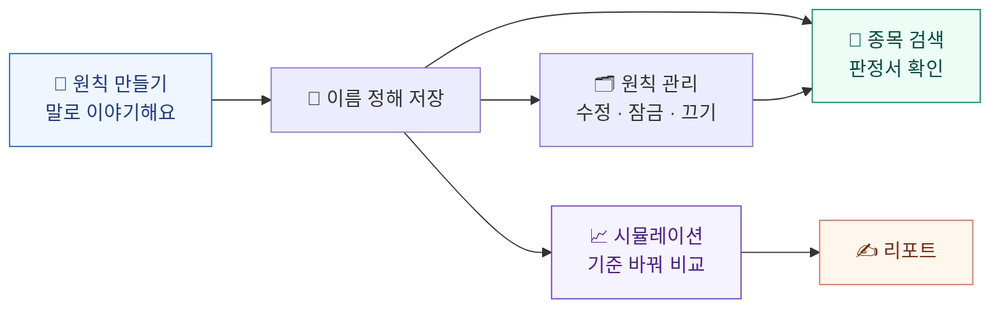
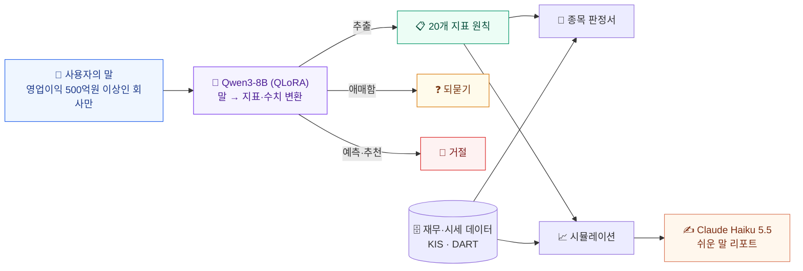

<div align="center">


<br />

**"영업이익 500억원 이상인 회사만 보고 싶어요."**
<br />
이 한 문장이면 충분해요. 나머지는 StockRuleKeeper가 숫자로 바꾸고, 종목마다 지켰는지 알려 줘요.

<br />


</div>

---

## 0. 프로그램의 목적과 결과

### 🎯 목적

- 투자 원칙을 세워도, 종목마다 그 원칙을 지켰는지 하나하나 확인하기는 어려워요.
- StockRuleKeeper는 **지표 이름을 몰라도 말로 원칙을 세우고**, 종목이 그 원칙을 **얼마나 지켰는지 숫자로 확인**하게 도와줘요.
- 원칙의 기준을 바꾸면 결과가 어떻게 달라지는지도 **과거 데이터 시뮬레이션으로 미리 비교**해 볼 수 있어요.
- 종목을 추천하거나 주가를 예측하는 앱이 아니라, **내 원칙을 지키도록 돕는 도구**예요.

### 🏁 결과

사용자가 앱에서 얻는 결과는 다음과 같아요.

| 사용자가 하는 일 | 앱이 돌려주는 결과 |
| --- | --- |
| 💬 원칙을 말로 이야기해요<br/>_"영업이익 500억원 이상인 회사만 보고 싶어요"_ | 20개 지표 중 **해당 지표를 골라 수치로 바꿔 줘요.**<br/>기준이 애매하면 **되묻고**, 예측·종목 추천은 **거절**해요. |
| 🧾 종목을 검색해요 | 내 원칙을 **몇 개 충족하는지** 알려 주는 판정서<br/>(예: 동진쎄미켐 **16 / 20개 충족**, 지표별 실제 값과 충족 여부) |
| 🗂️ 원칙을 관리해요 | 이름을 붙여 저장하고, 수치를 고치고, 지표를 잠그거나 꺼 둘 수 있어요. |
| 📈 원칙의 수치를 바꿔 봐요 | 바꾸기 **전·후 비교**(조건에 맞는 종목 수, 평균 수익률, 오른 종목 비율)와 **쉬운 말 리포트**<br/>(예: 부채비율 30% → 24%, 6개월 기준) |

그리고 말을 원칙으로 바꾸는 모델(Qwen3-8B QLoRA)은 264문항 평가에서 **전체 91.7%**를 기록했어요. (서버 4비트 환경, 팀 내부 평가)

> 표의 숫자는 실제 앱 화면에서 가져온 예시예요.

---

## 1. 프로그램의 흐름

<div align="center">

<br />
<sub>원칙 만들기 → 되묻기 → 거절 → 판정서 → 수치 수정 → 리포트</sub>
</div>

### 1-1. 전체 사용 흐름



앱 하단 메뉴는 **원칙 생성 · 원칙 관리 · 종목 검색 · 시뮬레이션 · 설정** 다섯 칸이고, 위 흐름의 각 단계와 하나씩 이어져 있어요.

### 1-2. 단계별 화면

#### ① 원칙 만들기

<table>
<tr>
<td align="center" width="33%"><br /><b>추출</b><br />말한 내용을 지표 수치로 바꿔요</td>
<td align="center" width="33%"><br /><b>되묻기</b><br />기준이 애매하면 다시 물어봐요</td>
<td align="center" width="33%"><br /><b>거절</b><br />예측·종목 추천은 정중히 거절해요</td>
</tr>
</table>

- 예: *"영업이익 500억원 이상인 회사만 보고 싶어요"* → 영업이익 **500억원 이상** 지표가 만들어져요.
- 만들어진 지표는 잠그거나, 수치를 직접 고치거나, 한 번 더 말해서 바꿀 수 있어요.
- 마음에 들면 **"이 원칙으로 시작해요"** 를 눌러 이름을 정해 저장해요.

#### ② 종목 판정서

<table>
<tr>
<td align="center" width="40%"></td>
<td>

종목 이름이나 코드로 검색하면, 내 원칙을 **몇 개 충족하는지**와 지표별 실제 값을 한 장으로 보여 줘요.

- 예: 동진쎄미켐 **16 / 20개 충족**
- 재무 건전성, 수익성 같은 묶음별로 **충족 / 미충족**을 확인해요.

</td>
</tr>
</table>

#### ③ 시뮬레이션과 리포트

<table>
<tr>
<td align="center" width="50%"><br /><b>수치 수정</b><br />원칙의 수치를 바꿔 봐요</td>
<td align="center" width="50%"><br /><b>리포트</b><br />바꾸기 전·후를 비교해 줘요</td>
</tr>
</table>

**원칙 선택 → 수치 수정 → 기간 선택 → 계산 → 리포트** 순서로 진행해요. 예를 들어 부채비율 기준을 30%에서 24%로 낮추면, 조건에 맞는 종목 수가 36개에서 23개로 줄어드는 식으로 결과를 비교해요. (배당은 포함하지 않아요.)

### 1-3. 내부 처리 흐름



### 1-4. 단계별 사용 기술

| 단계 | 사용 기술 | 설명 |
| --- | --- | --- |
| 말 → 원칙 변환 | **Qwen3-8B + QLoRA 파인튜닝** | 직접 만든 학습 데이터로 *추출 · 되묻기 · 거절* 세 가지 동작을 익혔어요. |
| 시뮬레이션 리포트 | **Claude Haiku 5.5** | 비교 결과를 읽기 쉬운 글로 풀어 써 줘요. |
| 앱 화면 | React · Vite · TypeScript | 모바일 화면에 맞춘 UI예요. 토스 인앱 배포를 염두에 두고 만들었어요. |
| 서버 | FastAPI · SQLite | 원칙과 종목 지표를 저장하고 판정해요. |
| 데이터 | KIS · DART | 시세와 재무 데이터를 가져와 20개 지표를 계산해요. |

모델의 유형별 평가 점수예요. (264문항 = 검증 234 + 새 문항 30, 서버 4비트 환경의 팀 내부 평가)

| 추출 | 되묻기 | 거절 | 전체 |
| :---: | :---: | :---: | :---: |
| **96.1%** | **80.6%** | **93.3%** | **91.7%** |

---

## 2. 폴더 구성

### 2-1. 전체 구조

```text
StockRuleKeeper/
├─ README.md                  이 문서
├─ docs/
│  └─ interface.md            팀 공통 약속: 함수 이름·데이터 형식
├─ .github/
│  └─ pull_request_template.md  PR 작성 양식
└─ members/                   팀원별 작업 폴더 (각자 자기 폴더에서만 작업)
   ├─ byungjun/
   ├─ yappang/
   ├─ hyeonkyeong/
   └─ haechan/
```

- 각자 `members/자기이름/` 안에서만 작업해요. 다른 사람의 폴더와 공용 파일은 고치지 않아요.
- 함수 이름과 데이터 형식은 [docs/interface.md](docs/interface.md)에 맞춰요.
- 커밋 메시지는 `[이름] 한 일` 형식으로 써요. (예: `[byungjun] 파서 함수 추가`)

### 2-2. 앱 폴더 안쪽 (`backend/`, `frontend/`)

실제로 돌아가는 앱이에요. `byungjun`, `yappang`, `hyeonkyeong` 폴더에 같은 구조로 들어 있어요.

```text
backend/                        서버 (FastAPI + SQLite)
├─ main.py                      서버 시작 지점
├─ api/                         앱이 부르는 요청 주소 (원칙 · 종목 · 시뮬레이션)
├─ services/                    요청을 실제로 처리하는 로직
├─ indicators/                  20개 지표의 정의 · 계산 · 충족 판정
├─ llm/                         모델 연결 (말 → 원칙 변환, 리포트 작성)
├─ external/                    KIS · DART 연동 + 테스트용 샘플 응답(fixtures)
├─ db/                          SQLite 연결과 테이블 정의(schema.sql)
├─ batch/                       종목 목록 만들기 · 데이터 수집
├─ data/                        반도체 종목 목록 등 서버가 읽는 데이터
├─ scripts/                     연결 점검 · 동작 확인용 스크립트
├─ requirements.txt             필요한 파이썬 패키지
└─ .env.example                 환경변수 양식 (실제 .env는 올리지 않아요)

frontend/                       앱 화면 (React + Vite + TypeScript)
├─ src/
│  ├─ screens/                  화면들 (원칙 채팅, 종목 검색, 판정서, 시뮬레이션 …)
│  ├─ components/               버튼 · 말풍선 · 지표 카드 같은 공통 부품
│  ├─ layouts/                  하단 메뉴가 있는 공통 틀
│  ├─ store/                    앱 전체에서 같이 쓰는 상태
│  └─ api/                      서버 호출 함수
├─ android/                     안드로이드 앱 빌드용 (Capacitor)
├─ apps-in-toss.config.ts       토스 인앱 배포 설정
└─ package.json                 실행 · 빌드 명령과 필요한 패키지

virtual-app/                    앱 밖에서 앱 열기를 시험하는 가상 주식앱 페이지
```

### 2-3. 모델·데이터 폴더

말을 원칙으로 바꾸는 모델(Qwen3-8B)을 만들고 평가한 자료예요. 팀원 폴더 안에 있어요.

| 폴더 | 의미 | 위치 |
| --- | --- | --- |
| `data/` | 학습 데이터를 만드는 스크립트와 지표 정리, 검증 자료 | 모든 팀원 폴더 |
| `finetune_merged/` | 팀원 데이터를 합친 최종 학습·검증 데이터 | `byungjun` |
| `finetune_train/` | 학습 · 병합 · 평가 코드, 학습한 모델을 앱에 연결하는 스크립트 | `byungjun` |
| `data_fixed5_hk/`, `data_fixed6_hk/` | 오류를 고쳐 다시 만든 학습·평가 데이터 (fixed-6가 최종 모델의 데이터) | `hyeonkyeong` |
| `finetune_v1.0/` | Qwen3-8B 학습 · 평가 · 내보내기 코드와 실행 가이드 | `hyeonkyeong` |
| `finetune/`, `training-results-haechan/` | 학습 코드, 버전별 데이터, 학습 결과와 평가 기록 | `haechan` |
| `q4b-finetune-haechan/`, `train_model_q4b/` | 작은 모델(Qwen3 4B)로 한 학습 자료 | `haechan`, `yappang` |
| `docs/` | 작업 기록, 평가 결과, 모델 선정 과정 같은 문서 | `byungjun`, `yappang`, `hyeonkyeong` |

---

## 3. 실행 방법 (step by step)

(아래는 `members/byungjun/` 폴더 기준이에요. `yappang`, `hyeonkyeong` 폴더도 같은 구조라서 폴더 이름만 바꾸면 똑같이 돼요.)

### 준비물

| 준비물 | 확인한 버전 | 비고 |
| --- | --- | --- |
| Python | 3.12 | 서버 실행 |
| Node.js · npm | 24 | 앱 화면 실행 |
| Git | - | 저장소 받기 |
| API 키 | - | **실제 모드에서만** 필요해요 (KIS · DART · Anthropic) |
| Ollama · 모델 파일(약 5GB) | - | **실제 모드에서만** 필요해요 (Step 6) |

### 어떤 모드로 돌릴까요?

| | 🧪 체험 모드 (처음엔 이걸로!) | 🚀 실제 모드 |
| --- | --- | --- |
| 필요한 것 | 없음 (키 · 모델 불필요) | KIS · DART · Anthropic 키, Ollama와 모델 파일 |
| 데이터 | 비어 있어요. 종목 이름만 있고 시세·재무는 "데이터 없음"으로 나와요 | 한투 · DART에서 받아 DB에 저장 (Step 5, 필수) |
| 말 → 원칙 변환 | 말과 상관없이 **고정된 샘플 결과** | 모델이 실제로 변환 |
| 용도 | 화면 구성과 원칙 만들기 흐름 둘러보기 (판정서 · 시뮬레이션 값은 비어 있음) | 시연 · 실제 사용 |

### Step 1. 저장소 받기

```bash
git clone https://github.com/Miita212/StockRuleKeeper.git
cd StockRuleKeeper/members/byungjun
```

### Step 2. 서버 패키지 설치

```bash
cd backend
python3 -m venv .venv
source .venv/bin/activate          # Windows(PowerShell): .venv\Scripts\Activate.ps1
pip install -r requirements.txt
```

### Step 3. 환경변수 파일 만들기

```bash
cp .env.example .env               # Windows: copy .env.example .env
```

`.env`를 열어 모드에 맞게 바꿔요. **`.env`는 키가 들어가므로 절대 올리지 않아요.**

```ini
# 🧪 체험 모드: 이 한 줄만 바꾸면 돼요
EXTERNAL_MODE=fixture

# 🚀 실제 모드: 아래 값을 채워요
EXTERNAL_MODE=live
KIS_APP_KEY=...
KIS_APP_SECRET=...
DART_API_KEY=...
ANTHROPIC_API_KEY=...             # 시뮬레이션 리포트는 항상 Claude Haiku 5.5예요
LLM_PROVIDER=local                # 말 → 원칙 변환을 파인튜닝 모델로 (Step 6 참고)
LOCAL_LLM_MODEL=qwen3-8b-fixed6   # Ollama에 등록한 모델 이름
```

### Step 4. 서버 실행하고 확인하기

`backend/` 폴더에서 실행해요.

```bash
uvicorn main:app --host 0.0.0.0 --port 8000
```

- 처음 실행하면 DB(`backend/data/stockrule.db`)가 **자동으로 만들어지고** 종목 목록이 채워져요.
- 브라우저에서 확인해요.
  - http://localhost:8000/health → `{"ok":true, ...}` 가 보이면 성공
  - http://localhost:8000/docs → 서버가 제공하는 요청 목록(API 문서)

### Step 5. 데이터 받아 두기 (🚀 실제 모드는 필수)

DB 파일(`stockrule.db`)은 저장소에 없어서, 처음 받으면 종목 이름만 있고 시세·재무 데이터는 비어 있어요. 특히 재무 지표는 DB에 저장된 값만 쓰기 때문에 이 단계를 꼭 해야 판정서와 시뮬레이션에 값이 나와요. `backend/` 폴더에서 실행해요.

```bash
python batch/collect_data.py                    # 전체 (한투 약 10분 + DART 약 10분)
python batch/collect_data.py --codes 005930 000660   # 일부 종목만
```

이미 받은 종목은 건너뛰고 이어서 받아요. (다시 받으려면 `--force`) 팀원이 만들어 둔 `stockrule.db`를 받아 `backend/data/`에 넣어도 돼요.

> 🧪 체험 모드에서도 같은 명령(`--codes 005930`)으로 샘플 데이터를 채울 수 있지만, 일부 지표만 채워져요.

### Step 6. 말 → 원칙 모델 연결하기 (🚀 실제 모드만)

파인튜닝한 모델(Qwen3-8B + fixed-6 어댑터를 합쳐 4비트로 줄인 파일, 약 5GB)은 Hugging Face에 올려 두었어요. 받아서 Ollama에 등록하면 끝나요.

1. [Ollama](https://ollama.com)를 설치하고 켜요. (기본 주소 `http://localhost:11434`)
2. 모델 파일을 받아요. ([모델 저장소](https://huggingface.co/availablename2/stockrulekeeper-qwen3-8b-fixed6))

   ```bash
   pip install -U huggingface_hub
   hf download availablename2/stockrulekeeper-qwen3-8b-fixed6 --local-dir srk-model
   ```

3. Ollama에 등록해요.

   ```bash
   cd srk-model
   ollama create qwen3-8b-fixed6 -f Modelfile
   ollama list                       # qwen3-8b-fixed6 가 보이면 성공
   ```

4. `backend/.env`에 모델 이름을 적어요.

   ```ini
   LLM_PROVIDER=local
   LOCAL_LLM_MODEL=qwen3-8b-fixed6
   ```

> 모델 없이 실제 모드를 써 보고 싶다면 `.env`에서 `LLM_PROVIDER=anthropic`으로 바꿔요. 말 → 원칙 변환도 Claude가 해 줘요.

<details>
<summary>학습한 어댑터에서 직접 만들고 싶다면</summary>

위 파일은 아래 순서로 만든 결과예요. 베이스 모델 `Qwen/Qwen3-8B`(약 16GB)는 Hugging Face에서 받아요.

```bash
hf download Qwen/Qwen3-8B --local-dir models/Qwen3-8B
bash finetune_train/swap_adapter.sh <어댑터폴더> qwen3-8b-fixed6
```

`swap_adapter.sh`는 병준 PC 기준 경로(`/home/ai/llm_models` 등)와 llama.cpp 빌드가 필요해서, 내 환경에 맞게 고쳐서 써야 해요. 어댑터 파일은 저장소에 올리지 않아요.

</details>

### Step 7. 앱 화면 실행하기

새 터미널을 열어서 `frontend/` 폴더에서 실행해요. (서버는 켜 둔 채로)

```bash
cd frontend
npm install
npm run dev
```

터미널에 나온 주소(기본 `http://localhost:5173`)를 브라우저에서 열면 돼요. **모바일 화면 크기**(개발자 도구의 폰 보기)로 보면 가장 잘 보여요.

- 서버 주소를 바꾸려면 `frontend/.env`에 `VITE_API_BASE=http://서버주소:8000` 을 적어요. (기본값은 `http://localhost:8000`)
- 폰으로 보려면 노트북과 같은 Wi-Fi에서 노트북의 주소로 접속해요.

### Step 8. 가상 주식앱 열어 보기

서버가 켜져 있으면 http://localhost:8000/virtual-app/ 에서 가상 주식앱 페이지를 볼 수 있어요.

### 막힐 때

| 증상 | 확인할 것 |
| --- | --- |
| 앱에 "서버 연결 실패"가 떠요 | 서버(Step 4)가 켜져 있는지, `VITE_API_BASE` 주소가 맞는지 |
| `Address already in use` | 같은 포트를 쓰는 프로그램이 있어요. 끄거나 `--port 8001`처럼 다른 포트로 실행해요. |
| 말을 보냈는데 계속 같은 결과가 나와요 | 🧪 체험 모드(`EXTERNAL_MODE=fixture`)라서 그래요. 실제 모드로 바꿔요. |
| 실제 모드에서 모델이 응답하지 않아요 | Ollama가 켜져 있는지, `LOCAL_LLM_MODEL` 이름이 등록한 모델과 같은지 |

---

## 4. 팀원과 한 일

| 훈련생 | 깃허브 아이디 | 작업 폴더 |
| --- | --- | --- |
| 정해찬 | [`Miita212`](https://github.com/Miita212) | `members/haechan/` |
| 한병준 | [`ByJn1224`](https://github.com/ByJn1224) | `members/byungjun/` |
| 이현경 | [`gonggong77`](https://github.com/gonggong77) | `members/hyeonkyeong/` |
| 김병수 | [`yappang`](https://github.com/yappang) | `members/yappang/` |

### 정해찬 ([`Miita212`](https://github.com/Miita212))

**LLM 담당: 4080 QLoRA 파인튜닝·평가(v1\~v7), 학습 데이터 보강, 4B 비교 학습, 문서 작성**

- **역할과 기준**
  - 종목 추천이 아니라 **사용자의 투자 원칙을 점검하는 서비스**라는 기준을 지켜서, 판정은 LLM이 아니라 코드와 데이터가 하도록 했어요.
  - 11-04 팀 회의에서 정한 구조(입력 해석은 Qwen3-8B, 리포트는 Haiku 5.5)를 따랐어요.
  - 데이터 준비 계획표의 담당 8개(H4-a\~c, V-1, V-2, T-run, D2, D3)를 맡았어요. V-2와 T-run은 팀 회의(11-05)에서 제외되어 코드를 정리했어요.
- **학습 데이터 준비**
  - **시드 데이터 207개**(H4-a\~c): 지표 20개를 세 묶음(1\~7번 64개, 8\~13번 66개, 14\~20번 77개)으로 나눠 만들었어요. 마스터가 바뀌면 `build_seed_*.py`로 다시 만들 수 있어요.
  - **데이터 점검과 정정**: 팀이 합친 데이터를 검토해 라벨 오류를 바로잡았어요.
    - "배당을 꾸준히 뿌리는 회사"를 연속 배당 연수 지표 하나로 통일 (16행)
    - 다중 턴 대화 2행 복원, 되묻기 기준 점검, 부등호 라벨 35행 정정
    - 점검 이력을 `EDIT_LOG`와 `LABEL_AUDIT`에 남겼어요.
  - **보강 데이터 설계**: 시험에서 약했던 부분(거절, 지표 혼동, 부등호, 끝말, 되묻기)을 겨냥한 보강 데이터 생성기를 만들어 233행과 247행을 만들었어요.
  - **통합본(fixed-4) 검증**: 해시 일치, 평가·시험 문장과의 겹침(누수 0건), system 프롬프트·형식을 확인하고, 정답에 `anchors`가 빠진 문제를 찾아냈어요.
- **파인튜닝 (v1\~v7, 4B)**
  - Qwen3-8B QLoRA **학습 코드**(`train_qlora.py`), 환경 점검, 실행 스크립트, 어댑터 대화형 테스트 스크립트를 만들었어요. 기본값은 r=32, alpha=64, lr 1e-4, 3에폭이고, 4080 Super(16GB)에서 약 6시간(1,131스텝)이 걸렸어요.
  - **v1·v2**는 학습이 실패했고, 진단을 정리해 이후 참고하지 않도록 경고를 남겼어요.
  - **v3**: 원인이 `group_by_length` 옵션임을 찾아 끄고 다시 학습했어요.
  - **v4**: 거절·지표 혼동 보강 데이터 233행과 별도 시험 58건으로 학습했어요. (추출 전체 일치 82.1%, 거절 85.7%)
  - **v5**: 되묻기·부등호·끝말 보강(247행)과 라벨 정정 후 학습해 최종 후보가 되었어요. (공식 111건 추출 전체 일치 97.0%, 거절 92.9%, 처음 보는 문장은 80\~90%)
  - **v7**: 보강 데이터 생성기로 학습했지만 v5보다 낫지 않아서 v5 3에폭을 유지했어요.
  - **4B 학습**(Qwen3-4B, fixed-4 데이터): 4060 노트북에서 3시간 32분. 공식 111건 완전 일치 79.3%, JSON 100%로, 이전 4B보다 좋아졌지만 8B보다는 낮았어요.
  - **GGUF·Ollama 변환**: v5를 변환해 Ollama에 등록했지만 Ollama 평가 추출이 0%로 나왔고(합친 HF는 97.0%로 정상), 원인은 GGUF·양자화·Ollama 쪽으로 보여요.
- **데이터 검증 도구 (V-1)**
  - `validate_data.py`로 규칙 V1\~V10을 자동 검사하고, 테스트 코드 47개로 검사기를 확인했어요.
  - 학습 데이터를 합치는 단계에서 그대로 쓸 수 있어요.
- **시험·평가 세트**
  - 처음 보는 문장으로 점검하는 별도 시험 세트를 만들었어요. (58건, 추가 31건, v7용 34건)
  - 시험 문장이 개발에 계속 쓰이면 점수가 부풀 수 있다는 점을 짚어서, **공식 평가 점수와 새 문장 점수를 함께 보고**하도록 했어요.
- **조사 문서**
  - D2 기관별 용어 자료(`data/glossary_check.md`), D3 공개 금융 데이터셋 조사(`data/public_dataset_check.md`)
  - KRX-Bench와 KFinEval은 라이선스를 확인하지 못했어요.
- **환경·협업·발표**
  - 4080 Super(WSL)와 4060 노트북 환경을 맞췄어요. (torch 2.6+cu124, transformers 4.57.6, peft 0.21.2, bitsandbytes 0.50.2)
  - 팀 규칙(각자 폴더 수정, `[이름]` 커밋)을 지켜 `members/haechan`에만 올렸어요.
  - 결과 보고서(v1\~v7과 4B 통합), 학습 결과 폴더, 인수인계 문서(`HANDOFF-haechan.md`, `HANDOFF-발표-haechan.md`)를 정리해 팀에 공유했어요.
  - 발표자료(Gamma)의 내용 갱신을 맡았고, 현경님과 수정 범위를 조율했어요.

### 한병준 ([`ByJn1224`](https://github.com/ByJn1224))

**데이터 호출 구조 · 학습 데이터 병합 · UI와 백엔드 작동 문제 수정**

- **데이터 준비**
  - 지표 20개의 정의와 허용 부등호를 정리한 **지표 마스터**를 만들었어요.
  - 말이 애매할 때 어떻게 되물을지 정한 **되묻기 정책과 선택지**를 만들었어요.
  - 직접 만든 학습 데이터(S6·S7)와 검토표, 용어 점검 자료를 만들었어요.
- **학습 데이터 병합과 설정 명세**
  - 팀원들이 만든 학습 데이터를 한곳으로 **병합**했어요. 최종본은 학습 5,202건 / 검증 275건이에요.
  - 같은 질문이 학습과 검증에 함께 들어가지 않도록 **입력 단위로 나눴어요.**
  - 병합 과정에서 생긴 문제와 해결 방법, **파인튜닝 설정 명세**를 문서로 남겼어요.
  - 학습·병합·평가 코드와, 학습한 어댑터를 Ollama 모델로 바꿔 끼우는 **교체 스크립트**(`swap_adapter.sh`)를 만들었어요.
- **백엔드: 데이터 호출 구조**
  - FastAPI + SQLite 서버와 React 화면, 가상 주식앱을 **한 구조로 묶었어요.**
  - 한투·DART에서 종목 데이터를 받아 오는 방식을 **네 차례 고쳤어요.** 최종 구조는 "검색·판정서에서만 한투 최신 값을 쓰고, DB는 수집 명령으로만 갱신"이에요.
  - 반도체 종목 목록을 만들고, 장 마감 뒤 일봉이 자동으로 갱신되도록 했어요.
  - DB 연동 문서를 병준 백엔드 기준으로 **정리**했어요.
  - 한투 시가총액이 0으로 오는 경우를 처리했어요.
- **LLM 연결과 최종 모델 교체**
  - 파인튜닝 모델을 Ollama로 연결하고, 말 → 원칙 변환과 리포트의 **모델 역할을 나눴어요.** (변환은 파인튜닝 Qwen3-8B, 리포트는 Claude Haiku 5.5)
  - 팀이 고른 최종 모델 **fixed-6 8B**로 교체하고, 추출·되묻기·거절 동작과 화면에 나오는 문구를 앱에서 직접 입력해 확인했어요.
  - 리포트에 Haiku만 쓰는 이유와 호출 비용(1회 약 1.5원 수준)을 **정리**했어요.
- **UI 수정** (19개 항목)
  - 대기 중 **로딩 화면**을 넣고, 대화로 정한 지표를 "해당 지표"로 따로 보여 줬어요.
  - 기본값 지표를 원칙에 넣을지 고르는 **스위치**와, 지표 수치를 눌러 **직접 입력**하는 기능을 만들었어요.
  - 원칙 리스트에서 **밀어서 삭제 · 꾹 눌러 삭제**, 4개/6개씩 **페이지 목차**, 긴 이름이 흘러가는 효과, 이름 옆 **연필 아이콘으로 이름 수정**을 만들었어요.
  - "내가 설정한 지표값 상세보기" **시트**, 방금 정한 지표에 **빛 효과**를 넣었어요.
  - 여러 화면으로 나뉘어 있던 원칙 만들기를 **대화 한 화면**으로 합치고, "이 원칙으로 시작해요" 뒤 **이름 정하는 시트**를 만들었어요.
  - 지표를 꾹 눌러 또는 말로 **비활성화**하는 기능, 종목 검색 **공지 띠**, 답변 속 지표 이름 **굵게 표시**를 넣었어요.
- **앱에서 직접 대화하며 한 실사용 테스트와 오류 수정** (UI 작업과 함께 계속 진행)
  - 앱에서 실제로 말을 입력해 보며 **자연어가 알맞은 지표로 바뀌는지, 수치가 적절한지, 안내 문구가 자연스러운지**를 확인하고, 문제가 보일 때마다 바로 고쳤어요.
  - **지표 변환 보완**: 모델의 응답을 앱이 받아 정리하는 부분(`normalize`)을 보완해서, 잘못된 지표나 수치가 화면에 그대로 나오지 않게 했어요.
  - **기본값과 수치**: 지표별 기본값을 점검하고, 영업이익 기본값을 100억원 이상으로 바꾸고 기본값 지표를 불러오는 API를 추가했어요.
  - **문구 정정**: "원칙 n개"로 잘못 쓰인 요약 줄을 "지표 n개"로 바로잡고, 화면과 안내 문구를 실제 동작에 맞게 고쳤어요.
  - **되묻기 오류 해결**: 되묻기가 이어지다 엉키는 문제를 찾아 되묻는 중에는 입력창을 잠가 한 번에 한 주제만 다루게 했어요. "잠가줘 · 풀어줘" 같은 말도 화면에서 처리되게 했어요.
- **설정의 관리자 모드**: 앱을 켰을 때 **처음 보이는 화면을 고를 수 있게** 했어요.
- **정리와 공개**: UI·백엔드 수정 내역 문서와 앱 사용 화면 캡처를 정리하고, 최종 모델을 **Hugging Face에 올리고** 이 README를 **작성**했어요.
- **발표**
  - 발표 **PPT 초안을 작성**했어요. 발표 초안과 결과보고서 슬라이드를 읽으며 실제 구현과 어긋난 내용(원칙 변환 모델, 토스 인앱 등)을 찾아냈어요.
  - 슬라이드별로 어떤 내용을 어떻게 고칠지 정리해 **수정 지시문(프롬프트)을 작성**했어요. (원칙 관리, 시연·화면 흐름, 앱·백엔드 문제 해결, 리포트 비용 부록 장표 등)
  - 프로젝트 **최종 발표를 맡았어요.**

### 이현경 ([`gonggong77`](https://github.com/gonggong77))

**백엔드 LLM 연동 · 앱과 종목 DB 구현 · 8B 재학습 · 초기 UX/UI 설계**

- **기획·설계**
  - Notion 운영 보드를 `project_details/`로 정리했어요. (기획서, 일정, 단계별 기준)
  - 기획 문서를 정리하고 문서끼리 맞지 않는 부분을 맞췄어요. (지표 5\~6개 → 20개, FR 번호는 기획서 기준, 모델은 Qwen3-8B 하나로)
  - 공개 데이터셋(Sujet, financial-mmlu-ko)을 직접 받아 보고 쓰지 않기로 결정했어요.
  - Figma로 **UI 초안**을 만들었어요. (20개 지표 기준 화면 수정, 프로토타입 연결, 지표 잠금 자물쇠 컴포넌트, 13번 리포트 화면 다시 그림)
  - **시스템 흐름도**(Figma 새 페이지)와 팀 공유용 쉬운 기술 설명 문서(08)를 만들었어요.
  - **종합 리포트 LLM 설계 문서**(07)를 썼어요. 로컬 모델은 FR-01만 맡고, 리포트는 Haiku API가 쓰고, 숫자는 코드가 계산해요.
  - 기술을 정했어요.
    - 데이터는 한투 + DART, 종목 풀은 반도체 113개
    - 리포트는 Haiku API
    - 한투 실전 키는 조회만 하도록 코드로 막았어요.
    - 시연은 안드로이드로 진행해요.
- **앱 개발**
  - 백엔드(FastAPI + SQLite): 지표 20개 계산, 원칙 저장(버전 관리), 판정서, 종목 추천, 시뮬레이션과 Haiku 리포트, 공유하기 API
  - 프론트 화면 01\~14, 가상 주식앱, Capacitor 안드로이드 APK, 에뮬레이터에서 동작 확인
  - 지표 20개를 **검증하고 보정**했어요. 팀원 모듈과 대조해서 PER/PBR·EBITDA·금융비용·증가율·"N년 이상" 규칙을 고치고, 네이버 값과 5종목이 일치하는 것을 확인했어요.
  - 정합성을 수정했어요. (로컬 Qwen3 연결 코드, 기본값 8·9·15, 양방향 지표, 원칙 수정 시 설명 전체 다시 만들기)
  - 개발 환경을 Windows에서 리눅스(WSL)로 옮겼어요.
- **모델 학습**
  - 서버로 옮길 **학습 폴더**(GUIDE 11단계)를 만들고, 노트북에서 1.7B로 전 과정을 먼저 검증했어요.
  - ws3 서버에서 **8B를 학습**했어요. (기준선 → 스모크 → 본 학습 → 체크포인트 평가) 실패 원인(`group_by_length`)을 바로잡고 v1.0 자료를 올렸어요.
  - **GGUF 변환 → Ollama 등록 → 앱에 로컬 모델 연결**을 했고, 변환 스크립트를 8B·4B 공용으로 일반화했어요.
  - ws6 서버에서 data_v6으로 **재학습**(해찬님 v5 재현, 앱 모델로 교체)하고, fixed-4 학습·비교, 병수님 채점 기준으로 다시 비교했어요.
  - **학습 데이터 fixed-5**를 만들어 학습까지 했지만 데이터가 잘못돼 실패했어요. 이를 바탕으로 **fixed-6**을 만들었어요. (표현 기준 G1\~G7, 88줄 정리, 대조 문장 47개 추가, 시험 정답 수정안 9건)
  - fixed-6로 8B·4B를 학습하고 264문항으로 평가해서 **최종 모델을 선정**했어요. (fixed-6 8B 3에폭, 91.7%)
- **검증·시연 준비**
  - 의미 검증 34문장 스크립트를 만들었어요. (투자 관점에서 변환이 맞는지 확인)
  - 버그를 고쳤어요. (PER·PBR 0 값 처리, 장중에 받은 일봉 때문에 틀어진 거래량, 되묻기 2단계에서 문맥을 잃는 문제)
  - 장 마감 뒤 시세 자동 저장(`price_refresh`)과 화면의 가격 기준 시점 표시를 넣었어요.
  - 앱 기본 모델을 fixed-6 8B로 교체했어요.
  - 해찬님의 Galaxy 실기기에 설치하고 Wi-Fi로 접속(portproxy)했어요.
  - 가상앱 "공유하기"를 누르면 꺼져 있던 앱도 켜지며 판정서가 열리게 했어요. (딥링크)
- **문서·공유**
  - README, CHANGES.md(팀원 Claude가 바로 적용할 수 있는 변경 기록), 지표 정리 문서를 썼어요.
  - 학습 결과 문서를 정리했어요. (v1 리뷰, v6, fixed-4, 채점 기준 비교, 3모델 비교, 모델 선정 과정 history)
  - 팀에 데이터·어댑터 zip을 공유했어요. (fixed-5, fixed-6, 모델 3종)
  - 결과보고서 PPT를 강사 피드백에 맞춰 수정했어요. 발표용 버전 이름을 1.0\~7.0으로 바꾸고, 개선 장표를 문제/원인/해결/결과 틀로 다시 쓰고, 그래프 오류 2개(17쪽, 15쪽)를 고치고, 장표 순서를 정리했어요.

### 김병수 ([`yappang`](https://github.com/yappang))

**학습 데이터 생성 · 평가셋 · 4B 시연 모델 · 통합 데이터(fixed-4)와 Ollama 등록 절차 · DB 설계와 구현**

- **학습 데이터 생성**
  - 지표별 **동의어 사전**과 데이터 **생성 프롬프트 도구**(템플릿, 로컬 모델 실행기)를 만들었어요.
  - 생성한 S1·S2 데이터 중 검증을 통과한 **3,284건**을 만들었어요.
  - 생성 데이터를 사람이 확인할 수 있도록 **검수표**(지표 1\~7, 8\~13, 14\~20)를 만들었어요.
- **평가셋**
  - 8B·4B가 함께 쓰는 **시험 세트**(통합 234문항, 공식 111문항)를 만들었어요.
  - 정답 오류를 찾아 고쳤어요. (거절 정답 8건의 조사 오류, 표현 기준 G1\~G7에 맞춘 정답 10건)
- **통합 데이터 fixed-4**
  - 8B·4B 공용 **최종 학습 데이터 fixed-4**와 생성 코드를 만들었어요.
  - **병합 코드**(`merge_train_sets.py`)를 따로 만들어 같은 병합 결과가 재현되는지 확인했어요.
  - 현경님이 만든 fixed-5·fixed-6 데이터를 검증하고 결과 문서를 남겼어요.
- **4B 시연 모델 트랙**
  - Qwen3-4B 학습·평가 스크립트와 계획 문서를 만들고, v4까지 평가했어요.
  - 다른 노트북에서도 이어서 학습할 수 있게 **인수인계 문서**를 썼어요.
- **Ollama 등록 절차**
  - 팀의 8B 어댑터를 합쳐 Ollama에 등록하는 **적용 절차 문서**와 병합·평가 스크립트를 만들었어요.
- **DB 설계와 구현**
  - **DB 연동 문서**와 외부 API(한투·DART) 노트, DB 백업 스크립트를 만들었어요.
  - 파인튜닝 절차 문서를 정리했어요.

---

## ⚠️ 알려 드려요

- StockRuleKeeper는 **투자 원칙을 지키도록 돕는 도구**예요. 종목을 추천하거나 주가를 예측하지 않아요.
- 시뮬레이션은 **지난 데이터로 계산한 결과**이고, 앞으로의 수익을 보장하지 않아요.
- 투자 판단과 결과에 대한 책임은 사용자 본인에게 있어요.

<div align="center">

<sub>동국대학교 DAIVE 1기 · 장예찬팀</sub>


</div>
